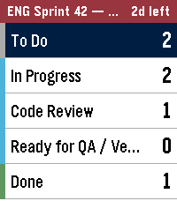
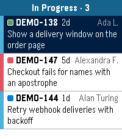
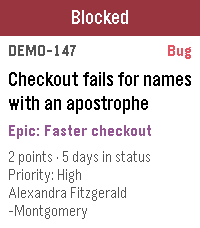

# Jira for Pebble

A Pebble watchapp for reviewing a Jira Cloud sprint from your wrist. It shows the active sprint of one board, grouped
by the board's columns, on a **Pebble Time 2**.

| Board | Column | Issue |
| --- | --- | --- |
|  |  |  |

## What it does

- **Board:** points done out of the sprint's total, days left, and each column with its points and issue count. The
  header turns red with two days or fewer left.
- **Column:** the issues in rank order, with the issue type's color, key, days in status, assignee and summary. A red
  stripe marks blocked and highest-priority issues.
- **Issue:** status, type, summary, epic, story points, days in status, priority and assignee.

The app is read-only.

## How it works

```
Watch (C app)  ←Bluetooth/AppMessage→  Phone (PebbleKit JS)  ←HTTPS→  Jira Cloud REST API
```

The watch app draws the UI and has no network access. PebbleKit JS on the phone calls Jira, loads the whole sprint
when the app opens, and sends the watch one column at a time. Your Jira credentials stay on the phone.

| Path | What it holds |
| --- | --- |
| `src/c/main.c` | The watch app: the home, column and issue windows |
| `src/pkjs/index.js` | The phone side: AppMessage handling and the config page events |
| `src/pkjs/jira.js` | The Jira Cloud client: board, columns, active sprint and issue search |
| `src/pkjs/settings.js` | Loads the settings the config page saved |
| `src/pkjs/config.js` | The config page (Clay) |

[NOTES.md](NOTES.md) has the design, the Jira API details and the open questions.

## Requirements

- A Pebble Time 2 (the SDK's `emery` platform) and the Pebble mobile app.
- The Pebble SDK 4.44 and `pebble-tool` 5.2.
- A Jira Cloud site and a board with an active sprint.
- A scoped Atlassian API token, created at
  [id.atlassian.com/manage-profile/security/api-tokens](https://id.atlassian.com/manage-profile/security/api-tokens)
  with "Create API token with scopes" and these scopes:
  - `read:jira-work`
  - `read:jira-user`
  - `read:board-scope:jira-software`
  - `read:board-scope.admin:jira-software`
  - `read:project:jira`
  - `read:sprint:jira-software`

Tokens expire. When yours does, paste a new one into the config page.

## Build and run in the emulator

```bash
npm install
pebble build
pebble install --emulator emery
pebble emu-app-config --emulator emery
```

`emu-app-config` opens the config page in your browser. Keep it running until you press Save. Then enter:

- **Site:** `yourcompany.atlassian.net`, or just `yourcompany`
- **Email:** your Atlassian account email
- **API token:** the scoped token
- **Board:** the board's name, its ID, or its project's key

A newly started emulator has no apps, so install the app before you open the config page.

## Install on a watch

1. In the Pebble mobile app, open the *Devices* tab, open your watch's ⋯ menu and turn on **Dev Connection**.
2. Run `pebble login` once, then `pebble install --cloudpebble`.
3. Allow the Internet permissions when the phone asks. The app needs `atlassian.net` and `api.atlassian.com`.
4. Open the app's settings from the Pebble mobile app and enter the same four settings.

If your phone and computer are on the same Wi-Fi, you can instead turn on *Use LAN developer connection* under
*Settings → Phone → Connectivity* and run `pebble install --phone <the phone's IP>`. That connection has no
authentication, so use it only on a trusted network.

`pebble logs --cloudpebble` (or `--phone <IP>`) shows the app's logs.

## License

MIT; see [LICENSE](LICENSE). `.claude/skills/pebble-watchface/` comes from
[coredevices/pebble-watchface-agent-skill](https://github.com/coredevices/pebble-watchface-agent-skill).
